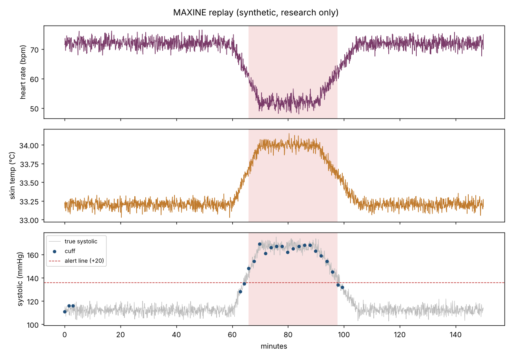

# Maxine — Open Patient Monitoring

**Open-source bedside vital signs monitor for research, education, and personal use.**

> ⚠️ **Not a medical device.** Maxine has not been cleared by the FDA and is not intended for clinical diagnosis, treatment, or monitoring in any medical setting. All readings are for personal awareness and research purposes only. Always consult a licensed medical professional for health decisions.

---

## What is Maxine?

Maxine is a wireless, modular, bedside patient monitoring system built on the ESP32 microcontroller and MicroPython. It watches heart rate, skin temperature, breathing and blood pressure through the night, with a first focus on autonomic dysreflexia: the sudden, dangerous blood pressure spikes that people with spinal cord injuries at T6 and above can have, often while asleep.

It began as a clinical question: after building a voice-activated hospital bed control system for quadriplegic patients in Puerto Rico (sponsored by [Volunteers for Medical Engineering](https://imagemd.org/services/medical-engineering/volunteer/)), we asked — *what comes after the bed?* Maxine is the answer we're still building.

**"Maxine" is the trigger word the original VME bed listens for. We carried the name forward.**

---

## What works today

The software side runs and is tested on a laptop; the firmware has not yet been run on the bench.

| Part | Status |
|---|---|
| Signal processing (`firmware/shared/vitals.py`): heart rate from a pulse waveform, respiration from chest motion, HRV, motion level | Tested on synthetic signals |
| Autonomic dysreflexia watch (`firmware/shared/ad_monitor.py`): learns a personal baseline, asks the cuff for a reading when heart rate or skin temperature turns, alerts only on a measured systolic rise | Tested; thresholds from Can-SCIP guidance |
| Safety supervisor (`firmware/shared/supervisor.py`): stale sensors, lost link and low battery are shown as faults, never as calm | Tested |
| BLE packet (`firmware/shared/ble_protocol.py`): 16 bytes, CRC-8, missing values sent as "unknown" rather than zero | Tested |
| Wearable and bedside firmware (`firmware/wearable`, `firmware/bedside`) | Written, compiles, bench-untested |
| Night replay (`tools/replay.py`) | Runs the real alert logic over a simulated night |



*Synthetic replay: as heart rate falls and skin temperature rises, MAXINE asks the cuff for readings and alerts once systolic pressure crosses baseline + 20 mmHg, then re-checks every two minutes until it settles.*

```bash
pip install -r requirements-dev.txt
pytest -q                                   # 19 tests
python tools/replay.py ad_episode --plot    # also: normal_night, sensor_dropout
```

---

## Architecture

Two units. The wearable senses; the bedside unit decides, measures blood pressure and alerts.

```
┌─────────────────────────┐   BLE, 1 packet / 5 s  ┌─────────────────────────┐
│     Wearable unit       │ ─────────────────────► │     Bedside unit        │
│  MAX30102  pulse        │                        │  AD monitor + supervisor│
│  MLX90614  skin temp    │                        │  BP cuff (ground truth) │
│  MPU-6050  breathing    │                        │  E-paper display        │
│  ESP32 + LiPo           │                        │  Buzzer, ESP32          │
└─────────────────────────┘                        └─────────────────────────┘
```

**Where it is heading (v2).** A chest unit with ECG and bioimpedance (MAX30001), a contact temperature sensor (MAX30208) and an IMU, and a bedside unit built around a validated cuff (A&D UA-651BLE or SunTech) and clinical-grade SpO₂ (Nonin or Masimo modules). The shared code above is written so those parts slot in behind the same functions.

---

## Hardware

Prototype v1 is about $140 of parts. See [`BOM.md`](BOM.md) for the list and [`docs/WIRING.md`](docs/WIRING.md) for pins.

---

## Firmware layout

```
firmware/
├── shared/                # Copied to BOTH units; also what the tests run
│   ├── vitals.py          # heart rate, respiration, HRV, motion
│   ├── ad_monitor.py      # autonomic dysreflexia watch, cuff in the loop
│   ├── supervisor.py      # stale data, link and battery faults
│   ├── ble_protocol.py    # 16-byte vitals packet, UUIDs, CRC
│   ├── sensor_manager.py  # fixed-size rolling sample windows
│   └── base.py            # MicroPython / CPython differences
├── wearable/
│   ├── main.py            # sample, compute every 5 s, send
│   ├── ble_peripheral.py
│   └── sensors/           # max30102.py, temperature.py, motion.py
└── bedside/
    ├── main.py            # receive, watch, cuff, display, alarm
    ├── blood_pressure.py  # UART cuff parser (adapt to your module)
    ├── ble/ble_central.py
    └── display/epaper.py
```

Everything in `shared/` uses only the Python subset MicroPython supports, so the code that ships on the device is the code the tests check.

---

## Getting started on hardware

1. **Flash MicroPython** on both ESP32 boards ([micropython.org](https://micropython.org/download/ESP32_GENERIC/)):
   ```bash
   pip install esptool mpremote
   esptool.py --chip esp32 --port /dev/ttyUSB0 erase_flash
   esptool.py --chip esp32 --port /dev/ttyUSB0 write_flash -z 0x1000 ESP32_GENERIC.bin
   ```
2. **Upload the wearable:**
   ```bash
   mpremote connect /dev/ttyUSB0 cp -r firmware/shared/ : + cp -r firmware/wearable/sensors/ : \
     + cp firmware/wearable/ble_peripheral.py : + cp firmware/wearable/main.py :
   ```
3. **Upload the bedside**, plus `epaper4in2.py` from [mcauser/micropython-waveshare-epaper](https://github.com/mcauser/micropython-waveshare-epaper):
   ```bash
   mpremote connect /dev/ttyUSB1 cp -r firmware/shared/ : + cp -r firmware/bedside/ble/ : \
     + cp -r firmware/bedside/display/ : + cp firmware/bedside/blood_pressure.py : + cp firmware/bedside/main.py :
   ```
4. **Wire it** per [`docs/WIRING.md`](docs/WIRING.md). Without a screen attached, the bedside unit prints vitals to the serial console.

---

## Website & Research Dashboard

`index.html`, `origin.html` and `dashboard.html` are the project site and the research dashboard. Static HTML, no build step.

---

## License

This project is licensed under **Creative Commons Attribution 4.0 International (CC BY 4.0)**.

You are free to:
- **Share** — copy and redistribute the material in any medium or format
- **Adapt** — remix, transform, and build upon the material for any purpose

Under the following terms:
- **Attribution** — You must give appropriate credit, provide a link to the license, and indicate if changes were made.

See [`LICENSE`](LICENSE) for full terms.

---

## Acknowledgements

- **Dr. Mauricio Lizama** — clinical partner, Puerto Rico
- **Volunteers for Medical Engineering (VME)** — project sponsor
- **Loyola University** — Engineering Design Project (EG 497/498)
- **Team:** Amelia Arabe, Alex Kranov, Madison Rolle, Chris Sabins

---

## Contributing

We welcome contributions from engineers, researchers, educators, and anyone who believes technology should serve human dignity. See [`CONTRIBUTING.md`](CONTRIBUTING.md) to get started.
